# ILA/ECA — 設計・障害調査・変更管理をつなぐAIツール

## はじめに

**閉域環境の構築・運用や、既存環境のクラウドリフトの経験をもとに、設計・障害調査・会議内容の確認・承認管理を一つにまとめたAIツールを開発しました。**

- ILA = Infrastructure Lifecycle Agent（インフラライフサイクル・エージェント）
インフラの構築・変更管理・障害対応・クラウド移行などを支援するAIエージェント。

- ECA = Enterprise Coordination Agent（企業内調整・意思決定支援エージェント）
会議内容の分析、決定事項の管理、関係者間の調整などを支援するAIエージェント。

主な機能は、次の4つです。

- **閉域環境からAWSへの移行設計**\
  AIエージェントが、現行環境の構成調査結果・設計書・通信要件から、AWS上の構成・移行手順・IaC案を作成します。初案の作成後に追加資料を渡すことで、設定値や未確定事項を反映して改訂できます。

- **アプリケーションから基盤へ調査を広げる障害対応**\
  AIエージェントが、例えばKubernetes上のアプリでエラーが起きたとき、アプリのログに加え、Pod・Service・通信設定、関連ジョブや設定変更などを調べます。取得した情報に応じて原因の仮説を見直し、必要な調査を進めながら、原因と解決案を検討します。

- **会議の発言と既存設計の矛盾確認**\
  AIエージェントが、構成変更や追加要件について話し合った会議音声を文字起こしし、そこで出た指示・提案を、対象システムの設計や作業記録と照合します。矛盾・変更点・確認事項を整理し、設計書の作成・改訂とレビューにつなげます。

- **AIの提案に対するレビュー・承認管理**\
  AIエージェントが設計案や修復案をGitLabへ提出し、承認者がレビュー・承認します。ツールは、どの案のどの版を誰が承認したかを管理します。

実装では、機能ごとに必要な処理を用意しつつ、**資料の取込み・検索、LLMへの接続、根拠・成果物の保存、レビュー・承認管理などを共通化**しました。また、ログ・設定の取得や修復の実行など、**対象によって異なる処理をAdapterへ分離しました。** 新しいアプリケーションやツールを調査対象に加える際は、その情報取得・操作用のAdapterと関連資料を用意することで、共通の調査・提案・承認の流れに組み込めます。

**アーキテクチャ設計・データ構造・検証基準の策定は自身で行い、生成AIを実装・修正・テストケース拡充の支援に活用しました。** 生成されたコードは要求仕様と照合し、実際の出力・実行結果と自動テストを通じて、想定した動作や、情報不足・権限不足・通信失敗などの異常時の処理を確認しながら開発しています。モデルについても実モデルでの比較を行い、機能ごとの判断品質・速度・必要リソースを検証しています。

本ツールはインフラ業務を出発点としていますが、共通化した資料検索、根拠付きの提案、人のレビュー、外部ツール連携などの仕組みは、社内問い合わせ・申請レビュー・会議後のタスク管理といった業務自動化にも応用できます。展開先の業務に合わせて資料・接続先・承認条件を整え、判断品質を検証して利用することを想定しています。

## ① 実装方法

### 操作画面

案件ごとに要件や資料を登録し、設計・障害調査・会議レビューなどを実行できるWeb UIを用意しました。生成した文書や調査結果は、根拠となる資料・取得情報と合わせて確認できます。追加資料を渡した設計の改訂や、保存した調査結果を踏まえた追加調査も、同じ案件から進められます。

操作画面と利用手順を見る

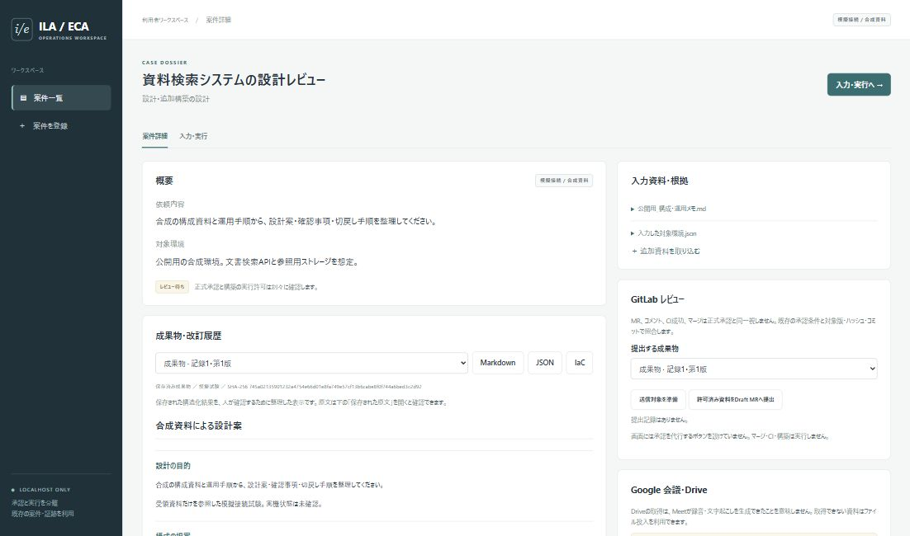

最新版UIの表示例。公開用の合成資料と模擬応答を使用

「案件詳細」で、依頼内容・保存した成果物・入力資料・レビュー欄をまとめて確認できます。実モデルの品質や実サービスの成功を示す画面ではありません。

| 操作 | 画面で行うこと |
|---|---|
| 1. 案件登録 | 業務の種類を選び、案件名・依頼内容・対象の情報を登録 |
| 2. 資料・要件の入力 | 設計書・構成情報・通信要件・会議資料などを追加し、制約や未確定事項を入力 |
| 3. 実行 | 「入力・実行」から処理を開始し、実行状況と結果を確認 |
| 4. 結果確認 | 「案件詳細」で成果物・根拠・改訂履歴を確認し、文書やIaC案をダウンロード |

設計の改訂や追加調査は、同じ案件へ資料・情報を追加して進めます。

### 機能を支える技術

| 技術・サービス                    | 使い方                                                    |
| -------------------------- | ------------------------------------------------------ |
| LLM・AIエージェント               | 要件・資料から設計案を生成。障害調査では取得結果を評価し、原因の仮説と次の調査を選択             |
| RAG                        | 設計書・運用手順書・技術資料を取り込み、関連箇所を検索して根拠付きの生成に利用                |
| Adapter                    | ログ・設定の取得や修復の実行など、対象によって異なる処理を分離                        |
| MCP                        | Google・GitLabが提供するツールを共通の接続方式で呼び出す。対象操作に応じてREST APIも併用 |
| Google Meet・Calendar・Drive | Calendarで予定を取得し、Meetの会議記録やDriveの資料を会議レビュー・資料の取込みへ渡す    |
| GitLab                     | 設計案・修復案をDraft MRへ提出し、人によるレビュー・承認と対象の版を関連付ける            |
| LangGraph | 機能の振り分け、処理の順序・分岐・繰返し、待機・再開を管理 |
| Pythonによる検査・保存 | 権限・版・設定値・参照を検査し、原資料・成果物・履歴を保存 |

**LangGraphで、ILA/ECA全体の処理の流れを管理しています。** RAGによる資料検索、LLMによる判断・生成、Adapterによる情報取得・操作、コードによる検査・保存を、各機能に必要な順序や条件でつなぎます。設計案の生成・検査・改訂、障害調査での仮説の見直しと追加調査、会議内容と既存記録の照合、承認待ちからの再開を、グラフの分岐・繰返し・待機として表現しています。

### RAGの構成と採用技術

RAGでは、設計書・運用手順書・技術資料から関連情報を検索し、その内容をLLMへ渡して、根拠付きの回答・提案を生成します。検索には、文書のチャンク化、ベクトル検索と語句検索を組み合わせたハイブリッド検索、RRFによる検索順位の統合を採用しています。

文書・チャンク・ベクトル・出典情報はSQLiteに保存し、検索対象の範囲と、回答に使用した原文・版・引用箇所を管理しています。

| 技術             | 用途                           |
| -------------- | ---------------------------- |
| 文書の分割（チャンク化）   | 原文・見出し・セクションとの対応を保持して検索単位を作成 |
| ベクトル検索・コサイン類似度 | 質問と資料のベクトルを比較                |
| 語句検索           | 質問と資料に含まれる語句の一致を評価           |
| RRFによる順位統合     | ベクトル検索と語句検索の順位を統合            |
| SQLite         | 文書・チャンク・ベクトル・出典情報を保存         |
| 検索範囲の制御・出典管理   | 許可された資料を検索し、原文・版・引用箇所を追跡     |

### 外部サービスとの連携

| 接続先             | MCPで扱う操作                    | REST APIを併用する処理             |
| --------------- | --------------------------- | --------------------------- |
| Google Calendar | 許可したカレンダーの予定取得              | Meet会議記録等の取得                |
| Google Drive    | 資料本文・指定形式の取得                | 版・ダウンロード権限の確認               |
| GitLab          | コミット、Draft MR作成、レビュー担当者の割当て | コミット・提出内容・承認者のID・権限・承認結果の照合 |

## ② 各個別機能

| 経路 | 機能                 | 入力から行うこと                |
| -- | ------------------ | ----------------------- |
| A  | 設計案の作成・改訂          | 要件・資料から設計案と手順を作成・改訂     |
| B  | 変更・作業計画            | 承認済み設計から作業計画を作成         |
| C  | 障害調査               | エラーから調査を進め、原因・修復案を整理    |
| D  | 設計・運用資料に基づく問い合わせ対応 | 資料を根拠に質問へ回答             |
| E  | 会議レビュー             | 発言を既存記録と照合し、矛盾・変更点を整理   |
| F  | 変更要否・状態確認          | 登録済みの構成・変更記録から状態を確認     |
| G  | AWS設計・IaC案         | 構成・要件からAWS設計とIaC案を作成・改訂 |
| H  | セキュリティレビュー         | 証拠からリスク・確認事項・対策候補を整理    |

A〜Hの詳しい処理・担当コードを見る

パスは本体の `ILA_ECA_REAL_DISCOVERY_LAB/` を基準にしています。画面側の受付は `webapp/portal.py`、A〜Hへの振り分けは `run_structured_design_v2.py` の `dispatch()` です。下表のファイルから、各機能の処理を追えます。

| 経路 | 機能                 | 担当する処理                             | 最初に読むコード                                                                          |
| -- | ------------------ | ---------------------------------- | --------------------------------------------------------------------------------- |
| A  | 設計案の作成・改訂          | 非AWS環境の設計案・手順と改訂履歴を作成              | `design/generation.py`、`design/non_aws.py`                                        |
| B  | 変更・作業計画            | 承認済み設計の作業計画を作成。隔離LABのファイル操作へ接続     | `design/generation.py` の `plan_approved_change()`、`lifecycle/execution.py`        |
| C  | 障害調査               | 結果を記録し、仮説を見直して次の調査を選択。原因・修復案を整理    | `incident/investigation.py`、`incident/reasoner.py`                                |
| D  | 設計・運用資料に基づく問い合わせ対応 | 資料を検索し、出典・根拠付きの回答を作成               | `design/context_routes.py` の `question()`                                         |
| E  | 会議レビュー             | 発言を設計・変更・作業記録と照合                   | `design/context_routes.py` の `meeting()`、`meeting/analysis.py`、`meeting/audio.py` |
| F  | 変更要否・状態確認          | 登録された構成・変更記録・根拠をコードで確認             | `design/context_routes.py` の `no_action()`                                        |
| G  | AWS設計・IaC案         | 初案・追加資料による改訂、設定値・Terraform JSONの検査 | `design/aws.py`、`design/cloud_draft.py`                                           |
| H  | セキュリティレビュー         | 証拠と関連資料からリスク・確認事項・対策候補を整理          | `design/context_routes.py` の `security()`                                         |

## ③ 共通処理の詳細

| 共通処理            | 役割               |
| --------------- | ---------------- |
| 資料の取込み・出典管理     | 資料の原文・版・出典を保持    |
| RAG検索           | 許可された資料から関連情報を検索 |
| 処理の進行管理 | 各機能の分岐・繰返し・待機・再開を管理 |
| LLM接続・応答記録      | モデルへの接続と入力・応答の記録 |
| 対象別Adapter      | 対象に応じた情報取得・操作    |
| Google・GitLab連携 | 会議・資料の取得と提案の提出   |
| 案件・成果物の保存       | 入力・根拠・提案・履歴を保存   |
| レビュー・承認管理       | 提案の版・承認者・承認結果を照合 |
| Baselineの管理 | 現行構成の基準とする設計・依存関係を版管理し、会議の発言や変更案との照合に利用 |

**Baselineは、対象システムの現行構成として登録した、照合の基準となる情報です。** 会議で出た提案や、承認済みでも実施前の変更は、現行構成と区別して管理します。変更の実施・結果確認・受入を経てBaselineを更新し、次の調査や会議レビューの基準にします。この更新手順はLABで検証しています。

共通処理の詳しい役割・担当コードを見る

パスは、本体の `ILA_ECA_REAL_DISCOVERY_LAB/` を基準にしています。

| 共通処理            | 役割・利用箇所                                      | 主な担当コード                                                                                           |
| --------------- | -------------------------------------------- | ------------------------------------------------------------------------------------------------- |
| 資料の取込み・出典管理     | 原文・出典・版・範囲・参照箇所を保持                           | `knowledge/intake.py`                                                                             |
| RAG検索           | 許可した資料のベクトル検索・語句検索を順位統合。現行UIのA・D・Hで同じ検索処理を利用 | `knowledge/intake.py`、`knowledge/index.py`                                                        |
| 処理の進行管理 | 各機能のグラフを実行し、処理段階と参照をSQLiteへ保存。承認・版・原資料は案件台帳で照合 | `core/workflows.py`、各機能のグラフ定義 |
| LLM接続・応答記録      | 送信・原応答・時間・使用量・終了理由を管理。機能に応じてローカル／クラウドへ接続     | `llm/generation.py`、`runtime.py`、`cloud.py`、`incident_cloud.py`（`llm/` 配下）                        |
| 対象別Adapter      | 調査時のログ・設定・稼働状態の取得と、承認した修復の実行                 | `incident/readers.py`、`product_api.py`、`lab_adapters.py`（`incident/` 配下）                          |
| Google・GitLab連携 | 会議・資料の取得、提案の提出、レビュー情報の取得                     | `collaboration/entry.py`、`google.py`、`gitlab.py`、`mcp.py`（`collaboration/` 配下）                    |
| 案件・成果物の保存       | 入力・根拠・提案・版・処理履歴を関連付けて保存・表示                   | `core/cases.py`、`storage.py`、`evidence.py`、`artifacts.py`（`core/` 配下）、`design/route_documents.py` |
| レビュー・承認管理       | 設計の版・差分・ハッシュ、承認者のID・権限・承認結果を照合               | `collaboration/approval.py`、`lifecycle/changes.py`、`design/change.py`                             |
| Baselineの管理 | 現行構成の基準を版管理し、会議の発言・変更案と照合。変更の実施・結果確認・受入後に更新 | `lifecycle/changes.py`、`meeting/analysis.py` |

Dは利用者向けの問い合わせ機能で、共通処理に当たるのは検索・出典管理です。Gは受領資料を設計入力として利用し、Eは文字起こしと既存記録を照合します。

## ④ それぞれのつながり

各機能が入力から結果までどう進むかを図にまとめました。全体像、機能別の処理フロー、コードの呼出し関係を、必要に応じて開いて確認できます。

全体の流れを見る

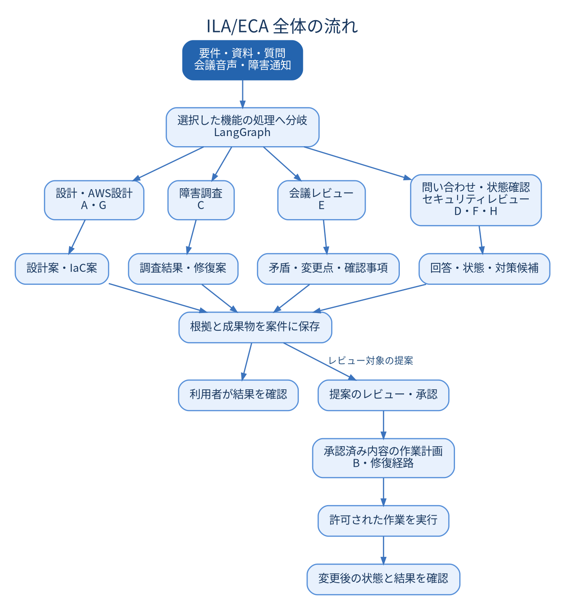

設計・調査・会議レビューなどの結果を案件として保存します。レビュー対象の提案は、人の承認を経て作業計画・許可された実行へ進みます。

機能別の処理フローを見る

### 設計案・AWS設計・IaC案の作成と改訂（A・G）

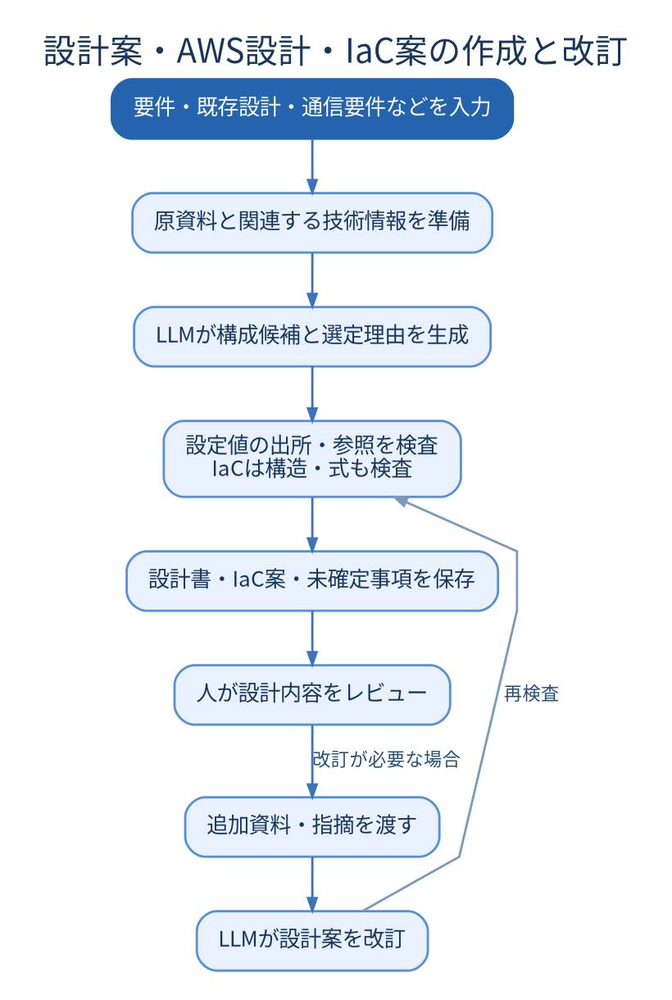

要件・資料から設計案を生成し、設定値の出所や参照を検査して保存します。追加資料やレビューの指摘を受けて改訂し、再び検査します。

### 障害調査と修復（C）

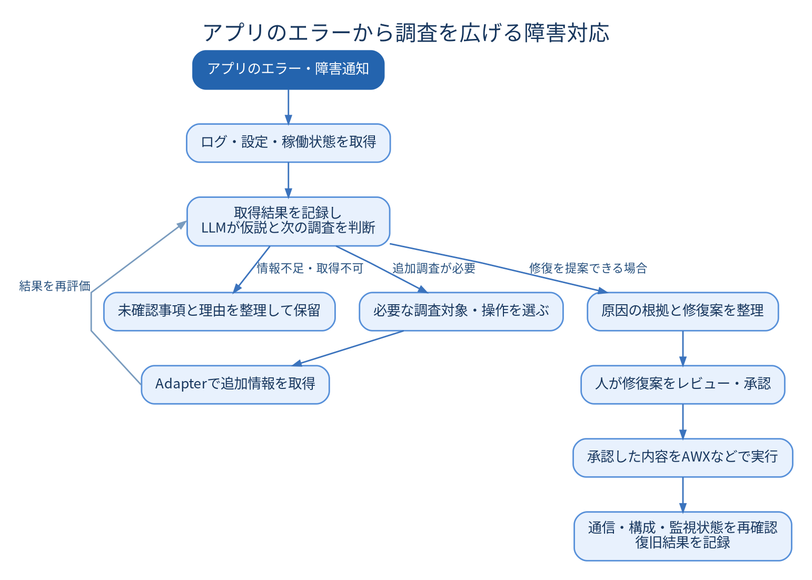

エラーと取得結果から仮説を立て、必要に応じてアプリ・基盤・通信・関連ジョブへ調査を広げます。結果を記録して仮説を見直し、修復案の承認・実行後に復旧を確認します。

### 会議レビュー（E）

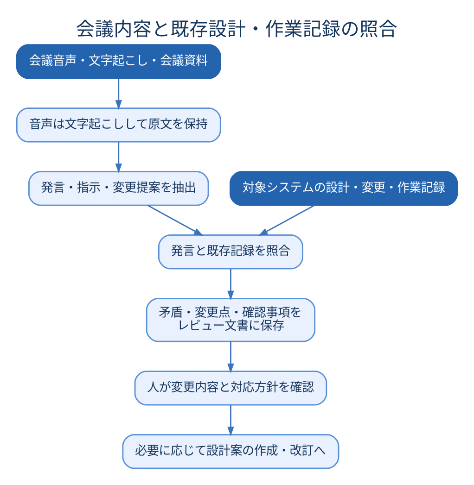

会議の発言・指示・提案を既存の設計や作業記録と照合し、矛盾・変更点・確認事項を整理します。人が内容を確認し、設計案の作成・改訂につなげます。

### 問い合わせ・状態確認・セキュリティレビュー（D・F・H）

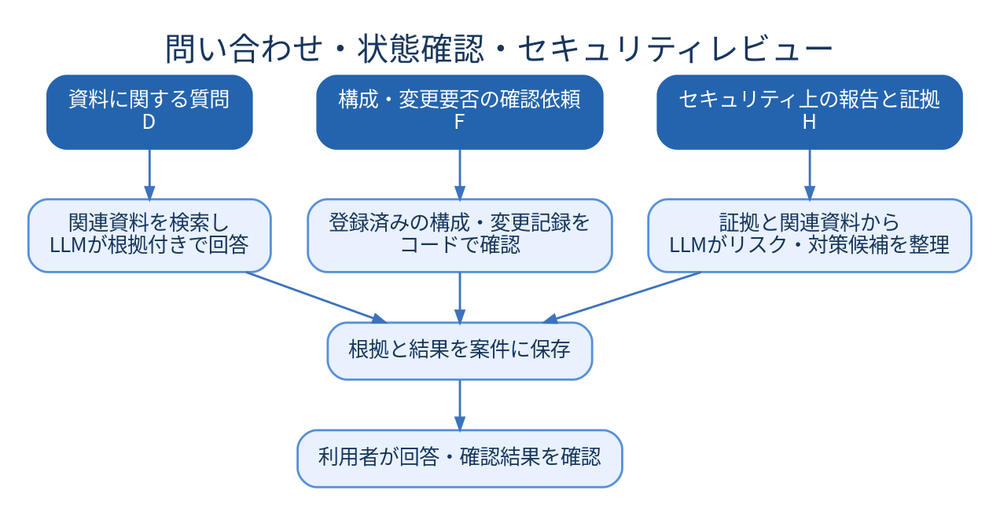

質問には関連資料から回答し、状態確認には登録済みの構成・変更記録を使います。セキュリティレビューでは証拠からリスクと対策候補を整理し、それぞれ根拠と結果を保存します。

### 提案の承認・作業計画・実行（B・承認／修復経路）

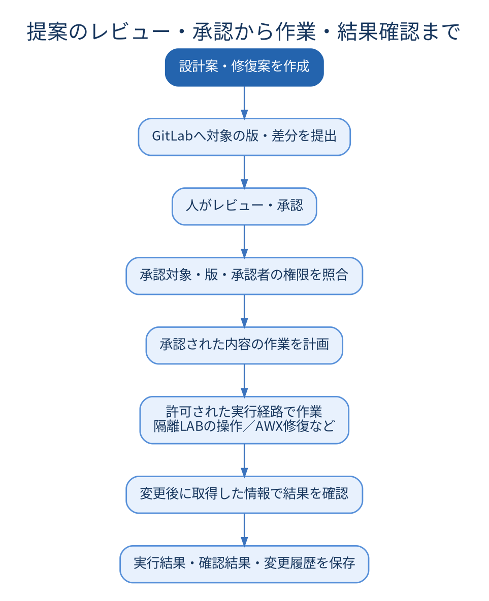

提案の版・差分をGitLabへ提出し、人がレビュー・承認します。承認対象と権限を照合したうえで作業を計画・実行し、変更後の状態と結果を記録します。

ソースコードの呼出し関係を見る

矢印は、主な呼出し・利用関係を示します。同じファイルに複数機能がある場合は、関数・処理を分けて表示しています。

### A・B・G：設計と作業計画

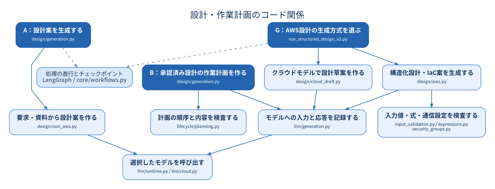

### C：調査結果から次の調査へ進む

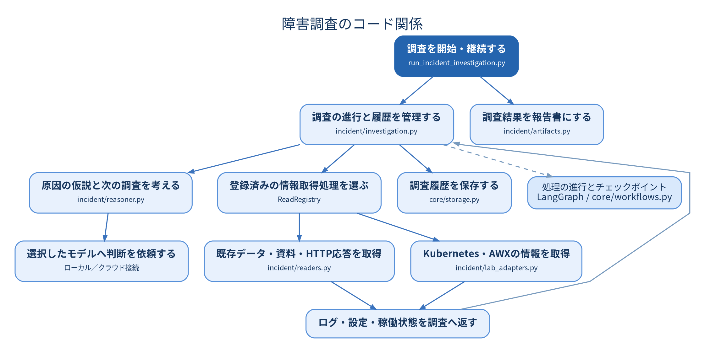

### D・E・F・H：問い合わせ・会議レビュー・状態確認・セキュリティレビュー

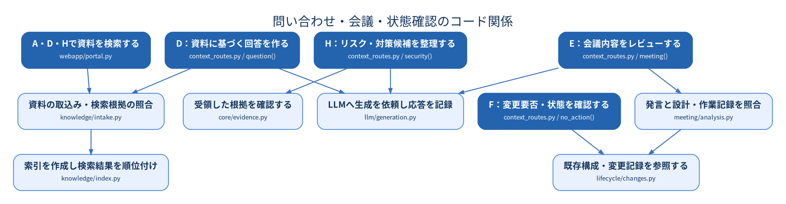

### 外部連携・承認・修復

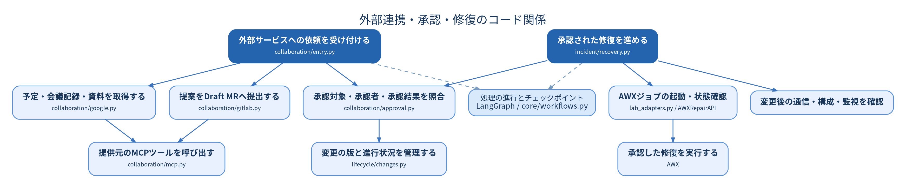

## ⑤ 機能検証とモデル選定

### ローカル8Bモデルによる機能検証

まず、ローカルの8Bモデルを使用して、A〜Hの各機能が期待どおりに動作するかを確認しました。一部の機能では期待した結果を得られましたが、比較的単純な事例での確認だったため、入力内容を変えた場合の判断品質も検証しました。

一方、次のような問題が残る機能もありました。

| 機能       | 検証で確認した問題                     |
| -------- | ----------------------------- |
| 障害調査（C）  | 取得した情報の解釈不足や、次の調査を指定する出力の不整合  |
| AWS設計（G） | 設計条件の取り違え、IAMの役割混同、根拠資料の誤った適用 |

入力形式や処理の構成を見直すとともに、通信・データの受け渡し・検査処理など、コード側の不具合を修正しました。また、情報不足・権限不足・通信失敗・不正なモデル出力などを扱い、必要な条件が整わないまま後続処理や操作へ進まないことも確認しました。

こうした修正により処理上の問題は改善しましたが、モデルによる判断の誤りは解消しきれませんでした。

### モデル比較と追加学習

そこで、**OpenAI APIのGPT-6.2 Astra・GPT-6.2 Solとの比較**と、**8Bモデルへの追加学習**を行いました。障害対応にはAstra、AWS構成案にはAstra・Solを使用し、原入力・参照資料・依頼内容などの条件をそろえて比較しました。評価では、要件の反映、主体や権限の整合性、機能の欠落、移行・切戻し手順などを確認しました。

| 試行          | 結果                                    |
| ----------- | ------------------------------------- |
| 上位モデルとの比較   | 8Bモデルで失敗していた評価ケースで、期待した結果を得られることを確認   |
| 8Bモデルへの追加学習 | 今回の教師データ・学習条件では全体設計の品質改善を確認できず、採用を見送り |

JSONなどの出力形式が正しいことと、内容が要件や仕様に適合していることは、別の評価項目として扱っています。

### 代表的な検証事例

#### 障害調査から承認・復旧まで

**アプリケーションの通信エラーをきっかけに調査を開始し、原因に応じて調査対象を広げられるかを検証しました。** 検証では、ローカルのKubernetes環境でServiceのselectorとPodラベルを不一致にし、通信障害を発生させています。

Astraを使った調査では、アプリケーションのHTTP応答から、Service・EndpointSlice・Pod・GitLabの設定へ調査を広げ、ServiceのselectorとPodラベルの不一致を特定して修復案を作成しました。

GitLabでの試験承認後、AWXジョブで設定を修正し、HTTP応答・接続先・監視状態を改めて確認することで、復旧までの一連の動作を確認しました。

#### コンテナ環境のAWS移行構成案の生成

Kubernetes上で、Webからの要求を受け付けるコンテナと、キューから取得したジョブを処理するコンテナを、それぞれ動かしている既存構成を入力しました。

上位モデルでは、次の2案が比較されました。

| 候補          | 選定時の考え方                                             |
| ----------- | --------------------------------------------------- |
| EKS         | 既存のKubernetes設定を引き継ぎやすく、Kubernetes固有の機能への依存が強い場合に有力 |
| ECS Fargate | コンテナの処理を維持しながら、Kubernetesクラスタの運用を持ち込まずに移行できる        |

生成結果では、**Kubernetes固有の依存がないことなどを成立条件として、ECS Fargateが採用案**になりました。Webの受付処理とジョブ処理を別サービスに分け、既存の保存先・キュー・データベースを引き継ぐ構成です。

評価では、候補の選定理由に加え、処理ごとのIAM権限、通信経路、移行・切戻し手順が、入力した要件や既存構成と整合しているかを確認しました。

### 検証結果

このように、コード側の不具合とモデルの判断品質を切り分け、8Bモデルでは解消できなかった誤判断が、上位モデルでは改善し、対象の評価ケースで期待した結果を得られることを確認しました。

代表的な実測の入力・生成結果・評価条件は[検証資料](ila-eca/docs/evaluation/README.md)、模擬回帰試験の例は[テストフォルダ](ila-eca/tests/unit/)にまとめています。

## 使用技術

| 領域         | 技術                                                                 |
| ---------- | ------------------------------------------------------------------ |
| 本体・画面・状態管理 | Python 3.12、LangGraph、SQLite、HTML／CSS／JavaScript |
| 推論・資料・音声   | Ollama、OpenAI API（GPT-6.2 Astra・GPT-6.2 Sol）、チャンク化・検索順位統合、ローカル音声認識 |
| IaC検査・外部接続 | Terraform JSON、python-hcl2／Lark、MCP Streamable HTTP、REST API       |
| 復旧実証・テスト   | kind／Kubernetes、Prometheus、AWX、Ansible、Python unittest、Node.js     |

## 公開するコード・資料

本体ソース、構成・コード解説、代表的なテストケース・実測資料・UI表示例を公開します。実測資料は、実アカウント情報・資格情報・内部DBなどを除いて整理しています。

この公開版はコードと資料を読むための構成です。ローカル起動・全回帰試験用の実行一式は別管理としています。

[コードの読み方・掲載範囲](ila-eca/docs/CODE_GUIDE.txt) · [代表的な検証資料](ila-eca/docs/evaluation/README.md)

このプロジェクトは個人開発のLAB実装です。
